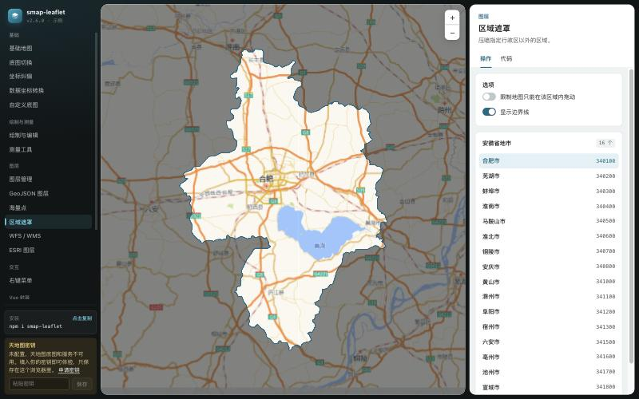

# smap-leaflet

[简体中文](README.md) | English

A mapping library built on [Leaflet](https://leafletjs.com/), with a Vue 3 wrapper. It bundles the base maps commonly used in mainland China, corrects their coordinate offsets automatically, and adds measuring, drawing and editing, marker clustering, and TianDiTu web services.

[](https://www.npmjs.com/package/smap-leaflet)
[](LICENSE)

**[Live demo](https://robeshell.github.io/leaflet-smap/)** (the demo UI is in Chinese)

[](https://robeshell.github.io/leaflet-smap/)

| Package                                      | Directory       | Description                                                                     |
| :------------------------------------------- | :-------------- | :------------------------------------------------------------------------------ |
| [`smap-leaflet`](packages/core/README.md)    | `packages/core` | Core library, framework-agnostic                                                |
| [`smap-leaflet-vue`](packages/vue/README.md) | `packages/vue`  | Vue 3 wrapper: `<SMapView>` and other components, plus `useMeasure` / `useDraw` |
| Demo site                                    | `example`       | Demos for both packages, importing their source directly                        |

> The API reference in each package's README is currently written in Chinese. Type declarations ship with both packages, and each package includes an `llms.txt` API summary for AI coding assistants.

## Install

```bash
npm install smap-leaflet leaflet
# for Vue 3 projects, also install
npm install smap-leaflet-vue
```

## Quick start

```ts
import { SMap } from 'smap-leaflet'
import 'smap-leaflet/style.css'

const smap = new SMap('#map', {
  tileType: 'GaoDe.Normal.Map',
  center: [31.82, 117.23], // [lat, lng], WGS-84
  zoom: 12,
})

// smap.instance is the underlying L.Map, so any Leaflet API or plugin still works
```

With Vue 3:

```vue
<template>
  <div style="height: 600px">
    <SMapView v-model:center="center" v-model:zoom="zoom" tile-type="GaoDe.Normal.Map">
      <SMapControl type="zoom" />
    </SMapView>
  </div>
</template>

<script setup lang="ts">
import { ref } from 'vue'
import { SMapView, SMapControl } from 'smap-leaflet-vue'
import 'smap-leaflet/style.css'

const center = ref<[number, number]>([31.82, 117.23]) // [lat, lng]
const zoom = ref(12)
</script>
```

`<SMapView>` fills its parent, so the parent element must have a height.

## Features

- **Base maps for China**: TianDiTu, GaoDe (AMap), Tencent, Baidu, Geoq and others, switchable at runtime. You can also register your own tile service.
- **Coordinate correction**: keep all your data in WGS-84. The library aligns GCJ-02 and BD-09 base maps to it, so overlays land where they should.
- **Measuring**: distance, area, circle and rectangle, with hectare and mu units. Results stay editable.
- **Drawing and editing**: points, lines, polygons, rectangles and circles, with snapping, undo and polygons with holes. Import and export GeoJSON. The engine is written from scratch and does not depend on leaflet-draw.
- **Layers**: managed by id, large point sets on a single canvas, marker clustering, area masks, WFS / WMS.
- **More**: context menus, browser geolocation, export the map as an image, TianDiTu search and geocoding.
- **TypeScript**: written in TypeScript, ships ESM and CJS builds with full type declarations.

## Development

This repository is a monorepo managed with npm workspaces.

```bash
npm install        # install dependencies for all workspaces, from the repository root
npm run example    # start the demo site at http://localhost:7999
npm run check      # type check + lint + format check + all unit tests
npm run build      # build both packages in dependency order
```

- Conventions and release process: [CONTRIBUTING.md](CONTRIBUTING.md) (Chinese)
- Notes for AI coding assistants: [AGENTS.md](AGENTS.md) (Chinese)
- Changelogs: [core](packages/core/CHANGELOG.md), [vue](packages/vue/CHANGELOG.md)

Issues and pull requests are welcome in English or Chinese.

## About tile services

This library only collects the tile URLs of various map providers in one place. **It does not provide or proxy any map data.** Before using a provider's base map, make sure your use complies with that provider's terms of service, apply for a key where required, and keep the attribution. TianDiTu requires a [key](https://console.tianditu.gov.cn/api/key).

## Acknowledgements

- The tile URL table was originally based on [Leaflet.ChineseTmsProviders](https://github.com/htoooth/Leaflet.ChineseTmsProviders).
- GCJ-02 / BD-09 conversion uses the publicly known algorithms common in the community.

## License

[ISC](LICENSE)
