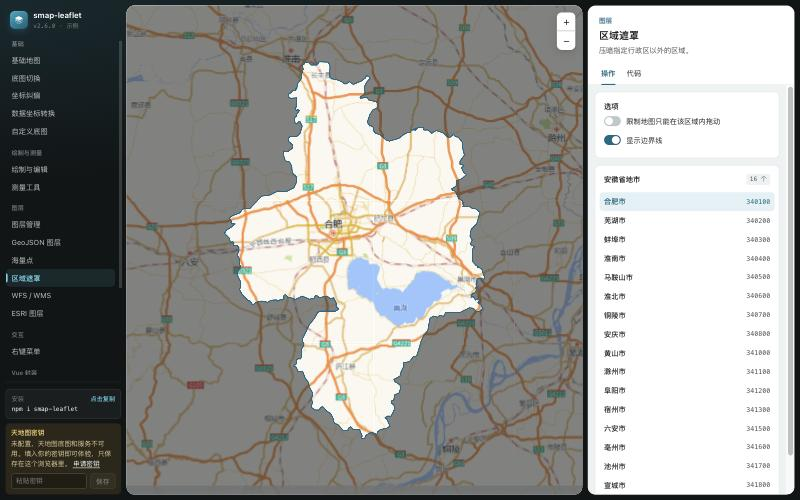

# smap-leaflet

简体中文 | [English](README.en.md)

基于 [Leaflet](https://leafletjs.com/) 的地图库及其 Vue 3 封装：国内底图、坐标自动纠偏、测量、绘制与编辑、点聚合、天地图服务。

[](https://www.npmjs.com/package/smap-leaflet)
[](LICENSE)

**[在线示例](https://robeshell.github.io/leaflet-smap/)**

[](https://robeshell.github.io/leaflet-smap/)

| 包                                           | 目录            | 说明                                                                  |
| :------------------------------------------- | :-------------- | :-------------------------------------------------------------------- |
| [`smap-leaflet`](packages/core/README.md)    | `packages/core` | 核心库，与框架无关                                                    |
| [`smap-leaflet-vue`](packages/vue/README.md) | `packages/vue`  | Vue 3 封装：`<SMapView>` 等组件和 `useMeasure` / `useDraw` 组合式函数 |
| 示例站                                       | `example`       | 两个包的示例，直接引用源码                                            |

## 安装

```bash
npm install smap-leaflet leaflet
# Vue 3 项目可以再装
npm install smap-leaflet-vue
```

```ts
import { SMap } from 'smap-leaflet'
import 'smap-leaflet/style.css'

const smap = new SMap('#map', {
  tileType: 'GaoDe.Normal.Map',
  center: [31.82, 117.23], // [纬度, 经度]，WGS-84
  zoom: 12,
})
```

完整文档见[核心库 README](packages/core/README.md)。

## 能做什么

- **国内底图**：天地图、高德、腾讯、百度、Geoq 等，运行时切换；也可以注册自己的瓦片服务。
- **坐标纠偏**：业务数据一律用 WGS-84，库负责把 GCJ-02 / BD-09 的底图对齐过来。
- **测量**：测距、测面、测圆、测矩形，支持公顷和亩，结果可编辑。
- **绘制与编辑**：点、线、面、矩形、圆；吸附、撤销、带洞多边形；导入导出 GeoJSON。自己实现，不依赖 leaflet-draw。
- **图层**：按 id 管理、海量点、点聚合、区域遮罩、WFS / WMS。
- **其他**：右键菜单、浏览器定位、导出图片、天地图搜索与地理编码。
- **给 AI 用**：每个包都随包发布 `llms.txt`，让 AI 编码助手写对 API。

## 开发

本仓库是 npm workspaces 管理的 monorepo。

```bash
npm install        # 在根目录安装全部工作区的依赖
npm run example    # 在本地启动示例站 http://localhost:7999
npm run check      # 类型检查 + lint + 格式检查 + 全部单元测试
npm run build      # 按依赖顺序构建两个包
```

- 开发约定和发布流程：[CONTRIBUTING.md](CONTRIBUTING.md)
- 给 AI 编码助手的说明：[AGENTS.md](AGENTS.md)
- 更新日志：[core](packages/core/CHANGELOG.md)、[vue](packages/vue/CHANGELOG.md)

## 关于底图服务

本库只是把各家地图服务的瓦片地址整理到一起，**不提供也不代理任何地图数据**。使用某家底图前，请自行确认符合该服务的使用条款，并按要求申请密钥、保留版权标注。天地图需要[申请密钥](https://console.tianditu.gov.cn/api/key)。

## 致谢

- 底图地址表最初参考了 [Leaflet.ChineseTmsProviders](https://github.com/htoooth/Leaflet.ChineseTmsProviders)。
- GCJ-02 / BD-09 的转换使用社区通行的公开算法。

## License

[ISC](LICENSE)
